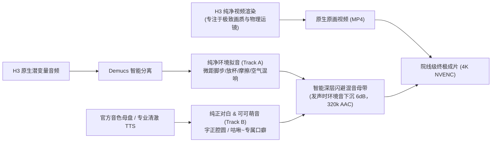

# 《小天气》AI 动画工业级生产总纲与黄金执行标准

> **版本**：v1.0 官方基准  
> **适用范围**：《小天气》第一卷及后续全集动画短剧生产  
> **设计目标**：确保全剧 100% 具备院线级 3D 治愈温润质感、顶流吉祥物可爱萌感、清澈纯净的人声拟音与电影级动感运镜。

---

## 一、视觉与角色形态绝对锁定规范

### 1. 核心视觉基调
* **画风**：3D Pixar-Ghibli 电影级温润质感，强调柔和次表面散射（SSS）、细腻光影丁达尔效应，严禁误写回 2D/日式赛璐璐；
* **抗融化指标**：单镜时序拉普拉斯方差衰减率 $< 20.0\%$，彻底杜绝尾帧边缘液化与面部溶解。

### 2. 角色特征六大刚性锁

#### 【角色 1：阿宁（A Ning）】
* **年龄与外貌**：8 岁中国小女孩，齐刘海，两侧低位蓬松自然微卷小马尾辫，深棕色清澈大眼睛，脸颊微红；
* **服饰状态锁**：
  * 校服场景：蓝白细条纹短袖衬衫，深蓝百褶裙，整洁白色翻领配藏青色蝴蝶结，粉色双肩书包；
  * 家居服场景：浅米色连帽卫衣，浅蓝水洗牛仔背带裤；
* **排他门控**：单人镜头严格只有阿宁唯一人类，严禁任何多余手臂、浮空断手或背景幽灵克隆。

#### 【角色 2：可可（Keke）——吉祥物核心资产】
* **材质与形态**：纯单色奶白棉花糖云团（`pure seamless cream-white marshmallow cloud fluff`），柔软Q弹果冻质感；
* **面部五官**：两颗高光黑珍珠豆豆眼，两团透亮水蜜桃粉红腮红，小圆嘟嘟嘴角，**绝对严禁绘制人类黑眉毛、严禁任何猫嘴与胡须**；
* **头顶云芽（灵魂标志）**：头顶正中央**严格只有唯一一枚天蓝色水滴状晶莹小云芽**，情绪激动时做有弹性的天线摆动；
* **足部与底座**：无独立脚趾、无爪子、无肉垫，站立时为圆润软布丁状云团支撑；
* **绝对纯净锁**：**100% 全身奶白，严格零斑点、零杂毛、零猫皮纹理、零杂质！**

#### 【空间刚性比例尺矩阵（尺度锁）】
为彻底消灭“体型橡皮筋失控”，所有镜头必须严格绑定以下相对参照物：
1. **阿宁手掌尺**：可可的完整体积 = 8 岁阿宁双手合捧的单颗雪媚娘大小（坐高 8cm，站高 15cm）；
2. **丹麦铁盒尺**：18cm 皇室蓝曲奇铁盒，可可坐下时高度刚好为铁盒深度的 1/2，内衬浅蓝色折叠棉布（严禁生成饼干）；
3. **大橘猫尺**：大橘猫“大福”体重 15 斤，体型体积为可可的 **4 倍以上**；
4. **扫地机尺**：扫地机直径 35cm、高 8cm，可可体积严格只有扫地机器人的 **1/4**。

---

## 二、声学工程黄金标准：双轨母带分离合封架构

彻底废弃“端到端音频直出”，实行**音画分立工业级制作流水线**：

### 1. 可可专属【咕啾~】口癖与发音规范
* **口癖核心音节**：软糯 Q 弹的“咕啾（Gu-chiu~）”与小奶音“哼咕（Heng-gu!）”；
* **发声情感变调规范**：
  * **撒娇治愈**：`“咕啾~✨”`（尾音上扬软糯，带轻盈水汽气泡音）；
  * **傲娇逞强**：`“哼咕！”`（短促有弹性，短小下巴扬起时的轻哼）；
  * **受惊缩盒**：`“咕呜——？！”`（软糖拉长般的抽气倒吸萌叫）；
  * **奶凶宣战**：`“啵哩咕啾！”`（可爱连珠泡泡声，绝不沉闷）。

### 2. 物理拟音 ASMR 参数标准
* 拟音底噪（Room Tone）严格保持在 `-22dB ~ -25dB`（RMS 约 0.075），通透温润，杜绝数码零真空，杜绝高斯白噪；
* 金属敲击声（铁盒）：带通 `[1800Hz, 5500Hz]` 衰减正弦谐波，还原清脆悠扬延音；
* 齿轮减速声（扫地机）：带通 `[120Hz, 680Hz]` 阻尼降频扫频。

---

## 三、神态动作与动画弹性法则（Appeal & Squash-Stretch）

1. **奶凶原则（Cute Aggression）**：
   * 角色生气绝不写实凶狠，而是像受气的小面团“噗”地鼓起圆滚滚的身躯；
   * 两颊泛起水蜜桃腮红，两只小手叉腰，双脚离地小幅软弹跺脚（Micro-bounces），头顶蓝芽高频颤抖。
2. **受惊原则（Elastic Recoil）**：
   * 身体如布丁果冻被弹指击中，先纵向拉伸（Stretch）后迅速扁平滑入掩体（Squash），仅留一双圆眼窥视。

---

## 四、电影级动感运镜与转场法则

严禁三脚架死锁眼平机位，单片必须包含以下导演级视听调度：

1. **贴地低视角微距追踪（Low-Angle Ground Tracking）**：
   * 贴着木地板缝隙以 15mm 虫眼广角跟拍机械移动，制造微距大片质感；
2. **焦点深度转移（Rack Focus）**：
   * 前景道具与后景角色之间的毫秒级焦距平滑转移，引导观众视觉落点；
3. **升格慢动作与冲击震颤（Slo-Mo & Shake）**：
   * 魔法水汽与静电爆发瞬间采用 60fps 升格微距，剧烈碰撞时附带 2 帧微幅画面震颤；
4. **动作与光影匹配剪辑（Match Cut）**：
   * 利用圆镜反光、落入铁盒的重力动量进行切镜，实现时空连续性的无缝衔接。

---

## 五、RealESRGAN_x4plus 4K 院线超分辨率重构标准

1. **硬件独占与显存释放**：
   * 超分前必须调用 `/free` 彻底清空 ComfyUI 显存，确保 GPU 独占（RTX 5060 8GB VRAM）；
2. **编码参数标准**：
   * 分辨率：严格 `3840×2160`（Lanczos 算法硬件级插值拉升）；
   * 编码器：`h264_nvenc`，Preset `p4`，恒定质量 `CQ 18`，像素格式 `yuv420p`；
   * 音频流：无损直接复制（`-c:a copy`）或 320k 广播级 AAC 封装；
3. **温控静息**：
   * 单镜超分完成后强制执行 8 秒静息散热，保障显卡长周期连续运行稳定性。
